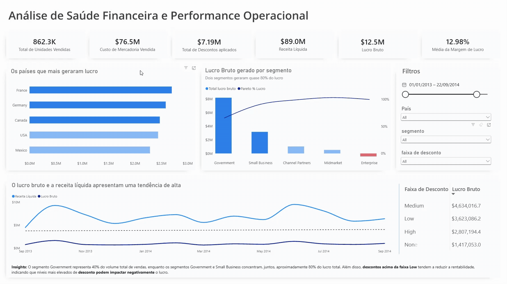

# Diagnóstico de Saúde Financeira e Performance Operacional Global


---

## 1. Contexto e Desafio de Negócio

Uma multinacional consolidada no mercado global, com operações distribuídas em cinco países e atuação em cinco segmentos estratégicos (Government, Enterprise, Small Business, Midmarket e Channel Partners), identificou oscilações nas margens financeiras, apesar do alto volume de vendas brutas.

A diretoria executiva necessitava de uma visão integrada e centralizada para relacionar o volume de vendas, os custos operacionais (COGS) e a concessão de descontos à lucratividade real por região e segmento.

## 2. Dashboard Interativo

O dashboard foi desenvolvido com foco na experiência do usuário (UX) executivo e na fluidez da navegação.

### Principais componentes

- **KPIs principais:** Receita Líquida, Lucro Total, Unidades Vendidas e Margem Percentual Média.
- **Performance operacional:** Comparativos de lucro e faturamento por segmento e país.
- **Análise temporal:** Visualização de tendências mensais e anuais para identificação de padrões ao longo do período.
- **Filtros dinâmicos:** Segmentação por país, segmento, ano, mês e faixa de desconto (*Discount Band*).

### Visualização do Dashboard



---

## 3. Objetivos do Projeto

- **Modelagem e limpeza de dados:** Tratar inconsistências nos tipos de dados, formatação monetária e registros nulos por meio de um pipeline reprodutível.
- **Análise exploratória e diagnóstica:** Mapear a performance operacional, identificando possíveis gargalos nas estratégias de precificação e concessão de descontos.
- **Business Intelligence e Storytelling:** Desenvolver um dashboard interativo para apoiar a tomada de decisão executiva.
- **Recomendações estratégicas:** Fornecer *actionable insights* direcionados à liderança para otimização de margens e alocação de capital no próximo ciclo orçamentário.

---

## 4. Tecnologias e Ferramentas Utilizadas

| Etapa | Ferramentas e Bibliotecas |
| :--- | :--- |
| Ingestão e tratamento de dados | Python (`pandas`, `numpy`, `kagglehub`) |
| Análise exploratória (EDA) | Python (`seaborn`, `matplotlib`) |
| Modelagem e visualização | Power BI, DAX e Power Query |
| Documentação e controle de versão | Git, GitHub e VS Code |

---

## 5. Estrutura do Repositório

```text
financial-performance-analysis/
│
├── dashboard/
│   └── dashboard.pbix
│
├── images/
│   └── dashboard.gif
│
├── data/
│   └── .gitkeep
│
├── notebooks/
│   └── Analise_financeira.ipynb
│
├── README.md
└── requirements.txt
```

---

## 6. Pipeline de Engenharia e Tratamento de Dados (ETL)

A preparação dos dados foi conduzida em Python, com o objetivo de garantir automação, consistência e reprodutibilidade.

As principais etapas foram:

**Fonte dos dados:** Dataset Financial Sample, disponibilizado no Kaggle. A identificação da fonte, o link e os detalhes de ingestão estão documentados no notebook de análise.
1. **Ingestão automática:** Conexão direta à API do Kaggle para carregamento das bases de dados.
2. **Padronização de nomes:** Normalização dos nomes das colunas.
3. **Limpeza e conversão numérica:** Remoção de caracteres de formatação (`$`, `,`), tratamento de valores nulos e conversão de valores negativos representados entre parênteses (`$(X)`) para o formato numérico decimal.
4. **Tipagem de dados:** Conversão e padronização dos tipos de dados, incluindo datas, valores monetários e quantidades numéricas.
5. **Validação de integridade:** Verificação de duplicidades e consistência lógica entre `Gross Sales`, `Discounts`, `Sales`, `COGS` e `Profit`.
---

## 7. Modelagem e Medidas DAX

Para garantir a precisão dos cálculos e a performance do relatório, foram desenvolvidas medidas em DAX. A seguir, estão algumas das principais regras aplicadas ao modelo.

### 7.1. Receita Líquida

```dax
-- 1. Receita Líquida Base
receita liquida =
SUM(clean_financials[receita líquida])
```

**Descrição:** Atua como a medida escalar primária de faturamento do modelo. Realiza a agregação aditiva direta por meio de `SUM`, servindo como base para os cálculos de margem, crescimento e indicadores avançados.

### 7.2. Total do Lucro Bruto

```dax
-- 2. Total do Lucro Bruto do Modelo
Total Lucro Bruto =
SUM(financials[lucro bruto])
```

**Descrição:** Executa a agregação aditiva da coluna `[lucro bruto]` da tabela `financials`. Serve como métrica base de rentabilidade absoluta para avaliar o resultado financeiro bruto gerado pelas operações do negócio.

### 7.3. Margem de Lucro (%)

```dax
-- 3. Margem de Lucro
Margem de Lucro (%) =
DIVIDE(
    SUM(financials[lucro bruto]),
    SUM(financials[receita bruta])
)
```

**Descrição:** Calcula a margem percentual consolidada por meio da divisão do lucro total pela receita bruta total, considerando o peso de cada venda no resultado geral.

### 7.4. Lucro Acumulado por Segmento

```dax
-- 4. Lucro Acumulado por Segmento
Lucro Acumulado =
VAR _RankingAtual =
    RANKX(
        ALL(financials[segmento]),
        [Total Lucro Bruto],
        ,
        DESC,
        Dense
    )
RETURN
    CALCULATE(
        [Total Lucro Bruto],
        FILTER(
            ALL(financials[segmento]),
            RANKX(
                ALL(financials[segmento]),
                [Total Lucro Bruto],
                ,
                DESC,
                Dense
            ) <= _RankingAtual
        )
    )
```

**Descrição:** Utiliza as funções RANKX, ALL e FILTER para ordenar os segmentos pelo lucro e calcular o lucro acumulado conforme sua posição no ranking. Essa medida serve de base para analisar a concentração da lucratividade entre os segmentos.

### 7.5. Percentual de Pareto Acumulado

```dax
-- 5. Percentual de Pareto Acumulado
Pareto % Lucro =
VAR _Acumulado = [Lucro Acumulado]
VAR _TotalGeral =
    CALCULATE(
        [Total Lucro Bruto],
        ALL(financials[segmento])
    )
RETURN
    DIVIDE(_Acumulado, _TotalGeral)
```

**Descrição:** Relaciona o lucro acumulado dos segmentos ao lucro total da empresa, identificando a concentração da lucratividade entre as categorias analisadas.

### 7.6. Formatação Condicional: Top 2 Segmentos por Lucro

```dax
-- 6. Formatação Condicional: Top 2 Segmentos por Lucro
Cor_Top2 Lucro segmentos =
VAR _Ranking =
    RANKX(
        ALL(financials[segmento]),
        [Total Lucro Bruto],
        ,
        DESC,
        Dense
    )
RETURN
    IF(
        _Ranking <= 2,
        "#2d80eb",  -- Cor de destaque
        "#8ab8f4"   -- Cor neutra
    )
```

**Descrição:** Atua como medida de formatação condicional baseada em contexto de classificação (`RANKX`). Retorna códigos hexadecimais personalizados para colorir dinamicamente barras ou cartões, destacando visualmente os dois segmentos mais lucrativos.

### 7.7. Formatação Condicional: Top 3 Países por Lucro

```dax
-- 7. Formatação Condicional: Top 3 Países por Lucro
Cor_Top3 Lucro países =
VAR _Ranking =
    RANKX(
        ALL(financials[país]),
        [Total Lucro Bruto],
        ,
        DESC,
        Dense
    )
RETURN
    IF(
        _Ranking <= 3,
        "#2d80eb",  -- Cor de destaque
        "#8ab8f4"   -- Cor neutra
    )

```

**Descrição:** Aplica a mesma lógica de classificação condicional à dimensão geográfica (`país`), permitindo destacar automaticamente os três países com melhor desempenho em lucro no dashboard.

---

## 8. Principais Insights

Com base na análise descritiva e diagnóstica dos dados históricos (2013–2014), destacam-se três pontos relevantes para a diretoria.

### 8.1. Desempenho por Segmento e Diluição de Margem

- **Maior volume líquido:** O segmento **Government** lidera em faturamento líquido total, impulsionado por contratos de grande volume.
- **Margem relativa:** O segmento **Channel Partners**, apesar de apresentar faturamento absoluto menor, entrega a maior margem percentual.
- **Ponto de atenção:** O segmento **Enterprise** apresentou resultado financeiro negativo, com prejuízo aproximado de 614,5 mil e margem de -3,13%, indicando que os custos dos produtos vendidos superaram a receita líquida.

### 8.2. Análise Geográfica e Consistência Global

- A receita e o volume de unidades vendidas mantêm uma distribuição relativamente homogênea entre os cinco países analisados (Canadá, Alemanha, França, México e EUA), indicando baixa dependência de um único mercado regional.
- Pequenas flutuações na margem percentual entre os territórios refletem a proporção de produtos com diferentes faixas de preço (*Product Pricing*) comercializados em cada região, conforme demonstrado pelas métricas de COGS e faturamento líquido.

### 8.3. Trade-off: Volume de Vendas vs. Lucratividade (Discount Bands)

A análise cruzada entre o volume de unidades vendidas (`Units Sold`), as faixas de desconto (`Discount Band`) e o lucro (`Profit`) revela um padrão relevante para a tomada de decisão.

- **Inflexão da margem:** Transações com descontos nas faixas **Medium** e **High** registram um volume significativamente maior de unidades vendidas em comparação à faixa **Low**.
- **Redução do lucro:** Apesar do maior volume de vendas, o ganho de escala não compensa a compressão da margem unitária. O lucro total acumulado nas faixas de desconto mais altas é inferior ao gerado em transações com descontos baixos (*Low*) ou nulos (*None*).
- **Conclusão diagnóstica:** Os dados indicam que as faixas de desconto Medium e High concentram maior volume de unidades vendidas, mas apresentam menor lucro acumulado em comparação à faixa Low. Esse comportamento sugere uma possível perda de eficiência na estratégia de descontos, indicando a necessidade de avaliar a rentabilidade das campanhas considerando também o produto, o segmento e o mercado.
---
## 9. Limitações da Análise

- Os dados representam um período histórico de 2013 a 2014.
- A análise é predominantemente descritiva e diagnóstica.
- Não foram avaliadas variáveis externas que poderiam influenciar a lucratividade.
- A relação entre descontos e lucro não estabelece, isoladamente, causalidade.

## 10. Autor

**Stevam Oliveira**

Data Analyst | SQL | Python | Power BI

- LinkedIn: [Stevam Kalebe de Oliveira](https://www.linkedin.com/in/stevamkalebe/)

